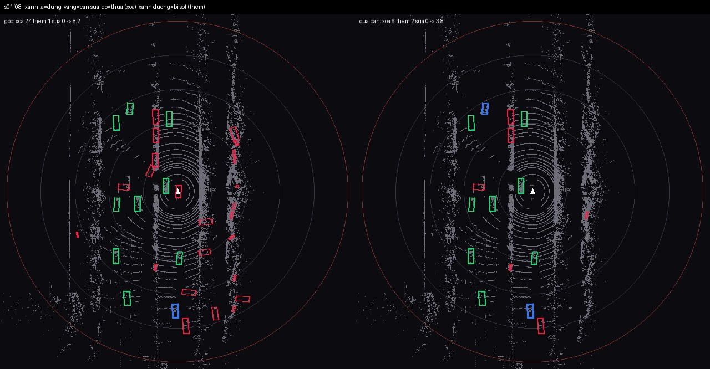

# Báo cáo Day 14 — Nguyễn Khánh Tùng — 2A202603144

- Mã học viên dùng với `--student`: `2A202603144`
- `seed_tag` trong `frames_A.txt`: `393590736f`

## 1. Dự đoán trước sweep (bước 5b)

Ghi **trước** khi chạy `scripts/pp_sweep.py`, rồi commit và push ngay (lịch sử commit là bằng chứng thời điểm viết). Không sửa phần này sau khi có kết quả.

- Tham số tôi nghĩ giảm công sửa nhiều nhất: tăng `score_thr` (khoảng `0.3–0.4`), có thể kết hợp `min_points` nhỏ (`5`) để lọc nhiễu ở vùng ngoài.
- Vì sao (nhìn ảnh BEV tập A: box thừa nhiều hay box sót nhiều?): Quan sát 3 ảnh tập A và kết quả sửa tay thấy các vùng ngoài cùng không có vật thể bị model gán box thừa rất nhiều (tổng 46 box phải xóa, chiếm 13,8/17,8 điểm chi phí gốc), trong khi số box bị sót rất ít (chỉ 1–2 box mỗi frame, tổng 4 box thêm) và gần như không có box bị đánh sai class (0 box sửa). Vì box thừa chiếm đa số chi phí và chủ yếu tập trung ở vùng rìa/điểm thưa, tăng `score_thr` (và lọc nhẹ `min_points`) được kỳ vọng sẽ cắt mạnh lượng box cần xóa mà không làm mất nhiều box thật.

## 2. Tập A: sửa tay và tune

| Cấu hình | Xóa | Thêm | Sửa | Chi phí |
|---|---:|---:|---:|---:|
| Gốc | 46 | 4 | 0 | 17.8 |
| `best_config.json` | 15 | 9 | 0 | 13.5 |

- Tham số đã đổi trong `best_config.json`: `score_thr`: `0.1` → `0.5`
- Kết quả leave-one-out (dán các dòng `scripts/pp_sweep.py` in ra):
```text
  s01f08: cấu hình chọn {'score_thr': '0.1', 'min_points': '5'} → 7.9 (tốt nhất có thể 3.8)
  s02f14: cấu hình chọn {'score_thr': '0.5', 'min_points': '0'} → 6.4 (tốt nhất có thể 4.9)
  s04f36: cấu hình chọn {'score_thr': '0.4', 'min_points': '5'} → 4.2 (tốt nhất có thể 3.3)
```
- Cấu hình có ổn định trên từng frame không? Vì sao tôi vẫn chọn (hoặc không chọn) nó: Cấu hình không thực sự ổn định trên từng frame vì leave-one-out cho 3 cấu hình khác nhau giữa 3 frame và đều chênh khá rõ so với mức tốt nhất (đặc biệt trên `s02f14`, `score_thr=0.5` làm chi phí tăng lên `6.4` so với mức gốc `5.5` và mức tốt nhất `4.9` ở `score_thr=0.3`). Với chỉ 3 frame tune, tôi chưa thể chắc chắn mức `0.5` tối ưu tổng quát và về lâu dài cần thử thêm các mức khác (như `0.3–0.4`) trên nhiều frame hơn; tuy vậy tôi vẫn tạm giữ `best_config.json` (`score_thr=0.5`) làm điểm xuất phát cho tập B vì nó đạt tổng chi phí thấp nhất trên tập A (`13.5` so với `17.8`) và mọi box tập B sau đó đều sẽ được tôi kiểm và sửa tay lại trên CVAT.

## 3. Trước/sau (bước 8)



- `scripts/pp_compare.py` báo giảm 24% công sửa trên tập A (tổng chi phí 17.8 → 13.5).
- Dự đoán ở mục 1 đúng hay sai? Giải thích bằng số box xóa/thêm/sửa: Dự đoán ở mục 1 đúng một phần. Đúng ở hướng chính là tăng `score_thr` giúp giảm công sửa nhiều nhất nhờ cắt mạnh box thừa từ `46` xuống `15` (`-31` box, giảm `9.3` điểm chi phí), giữ nguyên `0` box sửa, giúp tổng chi phí giảm `24%` (`17.8` → `13.5`). Tuy nhiên chỉ đúng một phần vì: (1) mức `score_thr` tối ưu trên tập A lên tới `0.5` thay vì `0.3–0.4` và phải đánh đổi tăng thêm `5` box bị sót (từ `4` lên `9`, tốn thêm `5.0` điểm), và (2) `min_points=5` gần như không tạo khác biệt thêm khi `score_thr=0.5` (cả `min_points=0, 5, 10` đều cho cùng chi phí `13.5`).

## 4. Tập B

Số đo từ `scripts/pp_prelabel.py --frames d14_2A202603144/frames_B.txt --config d14_2A202603144/best_config.json --gt d14_2A202603144/ref_B.json`:

| Xóa | Thêm | Sửa | Chi phí |
|---:|---:|---:|---:|
| 48 | 17 | 3 | 32.9 |

- Loại box tốn công sửa nhất ở tập B: **`Car`** (chi phí `11.5` — gồm xóa `30`, thêm `1`, sửa `3`), kế tiếp là **`Cyclist`** (chi phí `10.8` — xóa `16`, thêm `6`, sửa `0`). Tổng thể trên 12 frame tập B (`GT = 133`, `pred = 164`, `khớp = 116`), phần việc chính vẫn là xử lý box bị sót (`thêm = 17`, trọng số `1.0`) và lọc box nhiễu (`xóa = 48`, trọng số `0.3`), đặc biệt ở các lớp model KITTI yếu hoặc không có như `Truck`/`Bus`/`Cyclist`/`Pedestrian`.

| Lớp | Giữ nguyên | Xóa | Thêm | Sửa | Chi phí |
|---|---:|---:|---:|---:|---:|
| `Car` | 108 | 30 | 1 | 3 | 11.5 |
| `Cyclist` | 5 | 16 | 6 | 0 | 10.8 |
| `Truck` | 0 | 0 | 6 | 0 | 6.0 |
| `Bus` | 0 | 0 | 4 | 0 | 4.0 |
| `Pedestrian` | 0 | 2 | 0 | 0 | 0.6 |

## 5. Giới hạn

- **Chỉ tune trên 3 frame tập A dễ overfit:** như kết quả leave-one-out ở Mục 2 cho thấy, 3 frame chọn 3 cấu hình khác nhau và chênh đáng kể với mức tốt nhất của từng frame, nên `best_config.json` (`score_thr=0.5`) chưa chắc tối ưu đều trên toàn bộ tập B.
- **Lệch miền dữ liệu KITTI → VF:** PointPillars pre-trained trên KITTI (LiDAR 64 tia phía trước, chỉ có 3 lớp `Car`/`Cyclist`/`Pedestrian`), nên trên dữ liệu VF hoàn toàn không nhận diện được `Truck`/`Bus` (hay cắt nhầm thành `Car` hoặc bỏ sót) và bỏ sót nhiều đối tượng nhỏ/xa ở khu vực đông phương tiện.
- **Công thức chi phí chỉ là xấp xỉ quy ước:** `0.3·xóa + 1.0·thêm + 0.5·sửa` chưa phản ánh đầy đủ thời gian thật (chỉ tính box trong bán kính `50 m`, ghép bằng BEV IoU ≥ `0.3`, và chưa đo sự khác biệt giữa sửa nhẹ kích thước với vẽ mới hoàn toàn ở cả 3 góc nhìn Top/Side/Front).
- **Cỡ mẫu đánh giá còn nhỏ:** 12 frame tập B của một cá nhân chỉ mang lại nhận định bước đầu cho bài lab, không đủ để khái quát hiệu suất vận hành chung.

## 6. Điểm cộng — Hướng 1: Đo thao tác sửa nhãn tập B (Telemetry)

Dữ liệu thao tác được ghi trực tiếp bằng `bonus/cvat-telemetry-addon.user.js` trong suốt phiên sửa 12 frame của task `D14-2A202603144-B` (job 24), xuất thành 11 snapshot tích lũy và khử phần lặp lại để tính metric chuẩn trong [`d14_2A202603144/telemetry.csv`](../../d14_2A202603144/telemetry.csv).

### 6.1. Bảng metric thao tác theo chặng và toàn phiên

| Chặng (checkpoint không trùng lặp) | Click canvas | Phím tắt | Median gap (ms) | Mean dist (px) | Tỉ lệ phím | Thời lượng (s) | Top phím tắt |
|---|---:|---:|---:|---:|---:|---:|---|
| `seg01_d14-telemetry-job24-1795751991235.json` | 1 | 2 | - | - | 0.67 | 13 | `Ctrl+s×1 F12×1` |
| `seg02_d14-telemetry-job24-1795752486375.json` | 47 | 5 | 1550 | 134 | 0.1 | 483 | `Delete×4 F12×1` |
| `seg03_d14-telemetry-job24-1795753451526.json` | 193 | 14 | 1010 | 121 | 0.07 | 949 | `Delete×8 n×1 Ctrl+z×1 Escape×1 Ctrl+c×1` |
| `seg04_d14-telemetry-job24-1795754620861.json` | 399 | 20 | 1139 | 143 | 0.05 | 1152 | `Delete×8 Ctrl+v×3 F12×3 Ctrl+c×2 Ctrl+s×2` |
| `seg05_d14-telemetry-job24-1795755195153.json` | 209 | 9 | 1207 | 138 | 0.04 | 567 | `Delete×3 F12×2 n×2 Ctrl+s×1 Ctrl+j×1` |
| `seg06_d14-telemetry-job24-1795755494589.json` | 100 | 8 | 1365 | 154 | 0.07 | 289 | `Ctrl+s×4 Ctrl+c×1 Ctrl+v×1 F11×1 F12×1` |
| `seg07_d14-telemetry-job24-1795755989584.json` | 139 | 12 | 1410 | 153 | 0.08 | 324 | `Ctrl+s×5 Ctrl+c×2 Ctrl+v×2 Delete×1 Ctrl+z×1` |
| `seg08_d14-telemetry-job24-1795756197433.json` | 89 | 9 | 1429 | 175 | 0.09 | 194 | `Ctrl+s×4 Ctrl+c×2 Ctrl+v×2 F12×1` |
| `seg09_d14-telemetry-job24-1795756529121.json` | 184 | 20 | 1166 | 161 | 0.1 | 324 | `Ctrl+s×7 Ctrl+v×5 Ctrl+c×4 F12×2 Delete×1` |
| `seg10_d14-telemetry-job24-1795756638925.json` | 75 | 9 | 895 | 134 | 0.11 | 95 | `Delete×9` |
| `seg11_d14-telemetry-job24-1795757392667.json` | 297 | 17 | 1266 | 111 | 0.05 | 746 | `Delete×7 Ctrl+s×3 Ctrl+c×2 Ctrl+v×2 Ctrl+z×1` |
| **Tổng hợp cả phiên (đã khử trùng)** | **1733** | **125** | **1199** | **139** | **0.07** | **5495** (~91.6 phút) | `Delete×41 Ctrl+s×27 Ctrl+v×16 F12×14 Ctrl+c×14` |

### 6.2. Phân tích phím tắt, nhịp thao tác và đối chiếu chi phí tập B

- **Nhịp thao tác & phím tắt dùng nhiều:** Toàn phiên ghi nhận **`1733` click trên canvas** và **`125` lần nhấn phím tắt** (`keyboard_ratio = 0.07`) trong khoảng thời gian **`5495` giây** (~`91.6` phút). Trung vị khoảng nghỉ giữa 2 click là **`1199 ms`** (~`1.2 s`), khoảng dịch chuyển chuột trung bình giữa 2 click là **`139 px`**. Các phím dùng nhiều nhất: `Delete` (×41), `Ctrl+s` (×27), `Ctrl+v` (×16), `F12` (×14), `Ctrl+c` (×14), `n` (×4), `Ctrl+z` (×3), `Ctrl+j` (×3) (trong đó có `41` lần xóa bằng `Delete`/`Backspace` và `27` lần lưu `Ctrl+s`).
- **Đối chiếu với số liệu sửa tập B (`scripts/pp_prelabel.py --gt`):** Tập B có tổng cộng **`68` box cần tác động** (gồm **xóa `48`**, **thêm `17`**, **sửa `3`**, chi phí công thức = **`32.9`**). Quy đổi sơ bộ trên toàn phiên tương ứng trung bình **`144.4` click/frame**, **`25.5` click/box tác động** và **`80.8` giây/box tác động**.
- **Đánh giá trọng số `0.3 / 1.0 / 0.5`:**
  - Trọng số **xóa = `0.3`** so với **thêm = `1.0`** phản ánh khá sát xu hướng thực tế: xóa một box thừa chỉ tốn ~1–2 thao tác (`click chọn` + `Delete`), trong khi thêm mới một cuboid bị sót phải chọn nhãn/Shape, double-click đặt hộp, xoay góc nhìn, đối chiếu camera và kéo căn cả 3 mặt Top/Side/Front nên tốn nhiều click và thời gian hơn hẳn.
  - Tuy nhiên, nếu dùng `edit` (`0.5`) làm mức trung gian thì trên dữ liệu thực tế cần tách rõ mức độ sửa: chỉnh nhẹ vị trí/kích thước bằng kéo điểm chỉ tốn vài click, nhưng sửa đổi lớp kèm xoay đầu xe `180°` và căn lại kích thước dài-rộng-cao có thể gần tiệm cận chi phí thêm mới (nếu điều chỉnh từ log thực tế, có thể cân nhắc tỉ lệ xấp xỉ `0.2 : 1.0 : 0.4–0.6` thay vì `0.3 : 1.0 : 0.5`).

### 6.3. Giới hạn của dữ liệu telemetry

- **Chỉ là bằng chứng sơ bộ của 1 người trên 12 frame:** Không thể dùng dữ liệu một phiên cá nhân này để khái quát năng suất chung hay khẳng định hiệu quả thời gian cho cả dự án.
- **Đo theo chặng checkpoint thay vì tách tab riêng từng frame:** Do tải `__d14Telemetry.download()` 11 lần liên tiếp trong cùng một phiên tab CVAT (snapshot sau tích lũy thêm event của snapshot trước), các dòng trong `telemetry.csv` phản ánh từng chặng thời gian làm việc chứ không phải 12 phiên mở tab tách biệt hoàn toàn theo từng frame.
- **`active_span_s` bao gồm cả thời gian quan sát và nghỉ ngắn:** Khoảng thời gian từ event đầu đến event cuối của phiên bao gồm cả lúc xoay 3D, kiểm tra 7 camera hoặc đối chiếu viewer ngoài CVAT chứ không thuần túy là thao tác vẽ.
- **Thiếu log gán nhãn tay thuần (không pre-label) để đối chứng trực tiếp:** Không có baseline thao tác thật khi gán từ đầu trên cùng 12 frame tập B.
